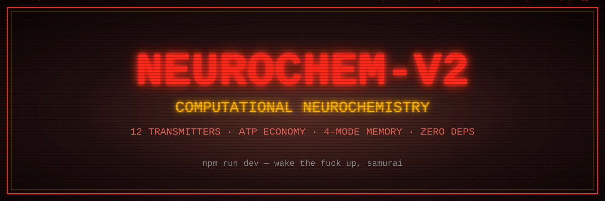

<div align="center">
  
</div>

# Night City Neurochem V2

A neurocomputational conversation agent: 12 neurotransmitter systems, an ATP
energy economy, and 4-mode memory drive a skeleton-based phrase engine, with
an LLM filling the frames into speech. Deterministic core, zero dependencies.

## Quick start

```bash
npm run dev          # talk (NVIDIA NIM Nemotron; needs NVIDIA_API_KEY)
npm run ollama       # talk via local Ollama instead
npm run dev -- --offline   # skeletons only, no network, no writes
npm run soul         # interactive wizard: write a new SOUL.md persona
npm test             # full suite (live-model tests skip without keys)
```

Environment (never commit these — see `.gitignore`):

```bash
export NVIDIA_API_KEY='...'   # 7-day keys work; required for npm run dev
# optional overrides:
export NVIDIA_MODEL='nvidia/nemotron-3-super-120b-a12b'
export OLLAMA_MODEL='qwen2.5:1.5b' OLLAMA_ENDPOINT='http://localhost:11434'
export SOUL_PATH='/path/to/alt-SOUL.md'   # persona override for any script
export NC_CHECKPOINT='/path/to/state.json' # checkpoint override (default .sessions/last.json)
```

## How it works (30 seconds)

- `src/neurochem/engine.js` — 12 NT systems × 3 compartments, tone scale (0.5 = rest).
- `src/energy/system.js` — ATP/ADP/AMP, glycogen, sleep pressure, circadian.
- `src/memory/store.js` — episodic + semantic + procedural + social + verbatim specs.
- `src/cognitive/` — ACT-R-style cycle + Plutchik/GoEmotions taxonomy.
- `src/phrase/engine.js` — word-skeleton candidates in the SOUL's accent.
- `src/interface/converse.js` — the 5-channel bridge: directive, narrative,
  tendencies, candidates, memories. The LLM writes; `validate.js` gates.
- `src/engine/ollama.js`, `src/engine/nvidia.js` — engine clients (OpenAI-compatible).

## Souls and memory

- `SOUL.md` is the **shipped default voice** (fictional). Keep it pristine —
  the test suite pins it.
- Live sessions write to `.sessions/soul.live.md` (auto-created copy):
  claimed names, `/remember` facts, distilled chapters. Delete it for amnesia.
- `/soul <path>` loads any persona file; `npm run soul` generates one.
- Checkpoints (`.sessions/last.json`) hold tones, energy, and episodes across
  restarts. Never commit `.sessions/` — it contains real conversation data.

## CLI commands

`/state /tend /accent /mem /soul /skeletons /remember /spec /save /reset /quit`

## Tests

```bash
node --test tests/validate.test.js   # single file
node --experimental-test-coverage --test tests/   # coverage (target >80% lines)
```

Live-model tests (`ollama.test.js`, `nvidia.test.js`) run for real when the
endpoint/key is present, otherwise skip. They cost minutes; the rest of the
suite runs in seconds.

## Verification

- `node --experimental-test-coverage --test tests/` — 96%+ lines, 84%+ branches.
- `hermes verify --skip-start` — **PASS** (bootstrap + full test phase).
- Live turns verified against `qwen2.5:1.5b` (local) and
  `nvidia/nemotron-3-super-120b-a12b` (NVIDIA NIM), including multi-turn
  memory, repair-loop, and soul-persistence probes.

## Strengths and limitations

Written like a discussion section, because that is what it is.

**Strengths.** The neurochemistry is a real dynamical system, not prompt
flavor text: 12 coupled transmitter compartments integrated per tick, read
out on a Weber–Fechner tone scale, with receptor-density tolerance and
sleep-driven homeostasis. Energy is a genuine currency — cognition spends
ATP, so fatigue degrades behavior instead of being roleplayed. Memory is a
single append-only log with four derived indices plus verbatim specs, all
serializable, so sessions survive restarts and personas travel in one
`SOUL.md`. The validator-plus-repair loop demonstrably converts model
failures (echoes, grunts, unprompted farewells, evasions) into passing
replies instead of dropping to fallbacks. Zero dependencies; the whole
thing runs anywhere Node 20+ runs.

**Limitations.** Appraisal is keyword heuristics, not understanding —
sarcasm, negation scope, and implication sail past it. The production
system ships nearly empty (two seeded rules); real cognitive breadth needs
authored tables. Nothing learns in weights — the "adapter log" is training
*data*, not training. Reasoning models take 8–60 seconds per turn, and the
3-attempt repair loop multiplies the worst case. Prompts grow with history
(~1.6–2k tokens/turn), so long sessions cost accordingly. Single user,
single persona per process (`personId` defaults); multi-party chat would
need routing that does not exist. Sleep, consolidation, and receptor
homeostasis almost never trigger in short sessions, so those paths are
tested but rarely lived. There is no human-subject evaluation and no
controlled comparison against a bare LLM — quality claims rest on the
behavioral suites plus live session transcripts. No safety filter beyond
the output contract: persona, model choice, and deployment context are the
operator's responsibility. Best quality currently depends on a hosted
endpoint (NVIDIA NIM free keys expire).
